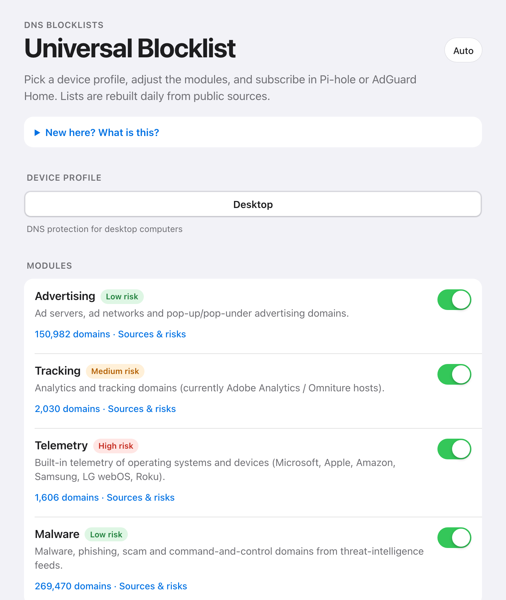

# Universal Blocklist

**Geräte wählen. Auswählen, was geblockt wird. Einen Link in Pi-hole oder AdGuard Home einfügen.**

[English](README.md) · **Deutsch**

**[Konfigurator öffnen →](https://jokeks2023.github.io/adaptive-blocklist/)**

Universal Blocklist erzeugt **DNS-Blocklisten** gegen Werbung, Tracker, Telemetrie und Schadsoftware, täglich neu aus öffentlichen Quellen.
Alles läuft auf GitHub (Actions für den Build, Pages fürs Hosting): kein Server, keine Datenbank, keine Kosten.

> **Neu bei DNS-Filtern?** Starte mit der **[Einsteiger-Anleitung](https://github.com/JoKeks2023/adaptive-blocklist/wiki/Einstieg)**. Sie erklärt Schritt für Schritt, was ein DNS-Filter ist
> und wie du ihn einrichtest. Probleme? Siehe **[Fehlerhilfe](https://github.com/JoKeks2023/adaptive-blocklist/wiki/Fehlerhilfe)**.

## Schnellstart

1. Installiere [Pi-hole](https://docs.pi-hole.net/main/basic-install/) oder [AdGuard Home](https://github.com/AdguardTeam/AdGuardHome#getting-started) und richte deine Geräte (oder den Router) darauf aus.
2. Öffne den **[Konfigurator](https://jokeks2023.github.io/adaptive-blocklist/)**, wähle deinen **Gerätetyp** (Desktop, Smart TV, Smart Home, Mobile, Gaming, Universal) und schalte **Module** und **Hersteller** ein oder aus.
   (Zum ersten Mal? Schalte **Telemetry** aus: Dieses Modul macht am ehesten Probleme.)
3. Kopiere die Listenadresse unter **Your list**.
4. **Pi-hole:** *Group Management → Adlists* (in v6 evtl. *Lists*) → einfügen → *Add* → *Tools → Update Gravity*.
   **AdGuard Home:** *Filters → DNS blocklists → Add blocklist → Add a custom list* → einfügen → speichern.
5. Etwas funktioniert nicht mehr? Klicke im Konfigurator auf **Report a problem**, wir beheben es für alle.

Fertige, dauerhafte Adressen:

| Was | Adresse |
|---|---|
| Gerätetyp, z. B. Desktop | `https://jokeks2023.github.io/adaptive-blocklist/lists/profiles/desktop.txt` (auch `smart-tv`, `smart-home`, `mobile`, `gaming`, `universal`) |
| Hersteller, z. B. Samsung | `https://jokeks2023.github.io/adaptive-blocklist/lists/vendors/samsung.txt` (auch `amazon`, `apple`, `microsoft`, `lg`, `roku`, `xiaomi`, `huawei`, `oppo-realme`, `vivo`, `tiktok`) |
| Advertising (Werbung) | `https://jokeks2023.github.io/adaptive-blocklist/lists/modules/advertising.txt` |
| Tracking | `https://jokeks2023.github.io/adaptive-blocklist/lists/modules/tracking.txt` |
| Telemetry (⚠ kann Updates und Geräte stören) | `https://jokeks2023.github.io/adaptive-blocklist/lists/modules/telemetry.txt` |
| Malware | `https://jokeks2023.github.io/adaptive-blocklist/lists/modules/malware.txt` |

Für jede Kombination zeigt der Konfigurator die dauerhaften Adressen zum Hinzufügen. Eine einzelne kombinierte Datei wird in deinem Browser zusammengesetzt
und hat **keine dauerhafte Abo-Adresse**; du kannst sie als TXT herunterladen und deine Auswahl als Link teilen.

## Gerätetypen, Module und Hersteller

| Modul | Blockt | Risiko |
|---|---|---|
| Advertising | Werbeserver, Werbenetzwerke, Pop-ups | Niedrig |
| Tracking | Analyse- und Tracking-Domains | Mittel |
| Telemetry | Eingebaute Telemetrie von Windows, Apple, Amazon, Samsung, LG, Roku | **Hoch**: kann Updates, App-Stores, Sprachassistenten blockieren |
| Malware | Schadsoftware, Phishing, Betrug, Command-and-Control | Niedrig |

Ein **Gerätetyp** (Profil) ist ein fertiger Startpunkt: Desktop, Smart TV, Smart Home, Mobile, Gaming oder Universal.
Eine **Hersteller**-Liste blockt die eingebaute Telemetrie eines Herstellers (Microsoft, Apple, Amazon, Samsung, LG, Roku, Xiaomi, Huawei, OPPO/Realme, Vivo, TikTok), damit du nur blockst, was du besitzt.
Module und Hersteller sind frei kombinierbar. Der Konfigurator zeigt dir die **dauerhaften Adressen**, die du abonnierst: eine Adresse, wenn es zu einem Gerätetyp passt, sonst die Liste des Gerätetyps plus je eine Liste pro Marke (z. B. *Smart TV + LG* = 2 Adressen). Pi-hole und AdGuard Home nehmen beliebig viele Listen an.
Smart TV, Smart Home und Gaming enthalten nur Malware-Schutz (Browser-Werbelisten helfen dort nicht), du ergänzt die Telemetrie deiner Marke.
Das Modul *Telemetry* enthält bereits alle Hersteller-Listen.

## Mithelfen

- **Eine Seite oder ein Gerät funktioniert nicht mehr:** [Problem melden](https://github.com/JoKeks2023/adaptive-blocklist/issues/new?template=broken-service.yml).
- **Eine Domain sollte geblockt werden:** [Domains vorschlagen](https://github.com/JoKeks2023/adaptive-blocklist/issues/new?template=block-domain.yml).
- **Fragen und Ideen:** [Discussions](https://github.com/JoKeks2023/adaptive-blocklist/discussions). Keine Frage ist zu einfach.
- Mehr in [CONTRIBUTING.md](CONTRIBUTING.md) (Englisch). Für Entwickler: Architektur, lokale Einrichtung, Quellen/Module/Profile hinzufügen und
  bekannte Einschränkungen stehen im [englischen README](README.md#for-developers).

## Lizenz

Code: [MIT](LICENSE). Die **erzeugten Listen** enthalten Daten aus Upstream-Quellen unter deren eigenen Lizenzen
(HaGeZi: GPL-3.0, StevenBlack: MIT). Jeder Listen-Header nennt Quellen und Lizenzen; wer Listen mit GPL-3.0-Daten weitergibt, muss die GPL-3.0 für diese Daten einhalten.
