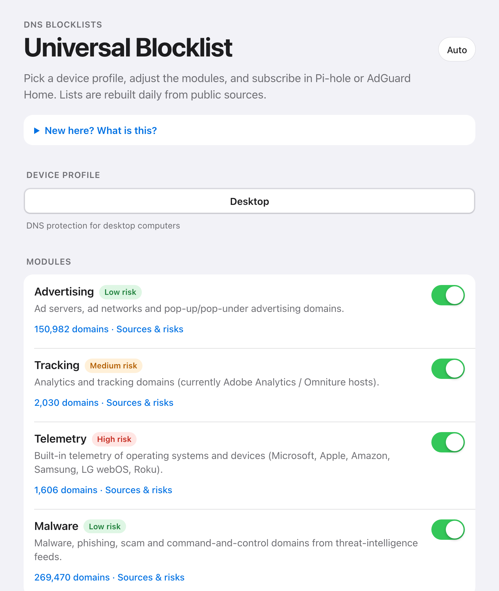

<div align="center">

# Universal Blocklist

**Pick your devices. Pick what to block. Paste one link into Pi-hole or AdGuard Home.**

[](https://github.com/JoKeks2023/adaptive-blocklist/actions/workflows/build.yml)
[](LICENSE)
[](https://github.com/JoKeks2023/adaptive-blocklist/discussions)

**English** · [Deutsch](README.de.md)

**[Open the configurator →](https://jokeks2023.github.io/adaptive-blocklist/)**



</div>

Universal Blocklist generates **DNS blocklists** for ads, trackers, telemetry and malware, rebuilt every day from public
sources. Everything runs on GitHub (Actions for builds, Pages for hosting): no server, no database, nothing to pay for.

> **New to DNS filtering?** Start with the **[beginner guide](docs/getting-started.md)**. It explains what a DNS filter is
> and walks you through it, step by step. Problems? See **[Troubleshooting](docs/troubleshooting.md)**.

## Quick start

1. Install [Pi-hole](https://docs.pi-hole.net/main/basic-install/) or [AdGuard Home](https://github.com/AdguardTeam/AdGuardHome#getting-started) and point your devices (or router) at it.
2. Open the **[configurator](https://jokeks2023.github.io/adaptive-blocklist/)**, choose your **device type** (Desktop, Smart TV, Smart Home, Mobile, Gaming, Universal), then switch **modules** and **vendors** on or off.
   (First time? Switch off **Telemetry**, it is the module most likely to break things.)
3. Copy the list address shown under **Your list**.
4. **Pi-hole:** *Group Management → Adlists* (*Lists* in v6) → paste → *Add* → *Tools → Update Gravity*.
   **AdGuard Home:** *Filters → DNS blocklists → Add blocklist → Add a custom list* → paste → save.
5. Something broke? Press **Report a problem** in the configurator; we fix it for everybody.

Ready-made addresses (replace nothing, they are permanent):

| What | Address |
|---|---|
| Device type, e.g. Desktop | `https://jokeks2023.github.io/adaptive-blocklist/lists/profiles/desktop.txt` (also `smart-tv`, `smart-home`, `mobile`, `gaming`, `universal`) |
| Vendor, e.g. Samsung | `https://jokeks2023.github.io/adaptive-blocklist/lists/vendors/samsung.txt` (also `amazon`, `apple`, `microsoft`, `lg`, `roku`, `xiaomi`, `huawei`, `oppo-realme`, `vivo`, `tiktok`) |
| Advertising | `https://jokeks2023.github.io/adaptive-blocklist/lists/modules/advertising.txt` |
| Tracking | `https://jokeks2023.github.io/adaptive-blocklist/lists/modules/tracking.txt` |
| Telemetry (⚠ can break updates and devices) | `https://jokeks2023.github.io/adaptive-blocklist/lists/modules/telemetry.txt` |
| Malware | `https://jokeks2023.github.io/adaptive-blocklist/lists/modules/malware.txt` |

Custom combinations made in the configurator are assembled in your browser: you can download them as a TXT file or share the
link, but they have **no permanent subscription address**. Subscribe to the module addresses instead.

## Contents

- [Modules and profiles](#modules-and-profiles)
- [Helping out: reports and suggestions](#helping-out)
- [For developers](#for-developers): [architecture](#architecture), [local setup](#local-setup), [sources](#add-a-source), [modules](#create-a-module), [profiles](#create-a-device-profile), [Pages setup](#configure-github-pages)
- [Known limitations](#known-limitations)
- [Licenses](#licenses)

## Device types, modules and vendors

| Module | Blocks | Risk |
|---|---|---|
| Advertising | Ad servers, ad networks, pop-ups | Low |
| Tracking | Analytics and tracking domains | Medium |
| Telemetry | Built-in telemetry of Windows, Apple, Amazon, Samsung, LG, Roku | **High**: may block updates, app stores, voice assistants |
| Malware | Malware, phishing, scams, command-and-control | Low |

A **device type** (profile) is a ready-made starting point: Desktop, Smart TV, Smart Home, Mobile, Gaming or Universal.
A **vendor** list blocks the built-in telemetry of one manufacturer (Microsoft, Apple, Amazon, Samsung, LG, Roku, Xiaomi,
Huawei, OPPO/Realme, Vivo, TikTok), so you only block what you own. You can change modules and vendors freely; a combination
that matches a device type uses that type's permanent address, anything else is assembled in your browser.
The *Telemetry* module already contains all vendor lists, so vendors it covers show as "included". More device types only need
a few lines of YAML, see [Create a device profile](#create-a-device-profile).
Every source (origin, license, purpose, status) is listed in the configurator under *Sources & risks* and in `data/catalog.json`.

## Helping out

- **A site or device stopped working:** [report a problem](https://github.com/JoKeks2023/adaptive-blocklist/issues/new?template=broken-service.yml).
  The configurator's button pre-fills your configuration and version.
- **A domain should be blocked:** [suggest domains](https://github.com/JoKeks2023/adaptive-blocklist/issues/new?template=block-domain.yml).
  A bot validates them and checks whether they are already listed; a maintainer reviews.
- **Questions and ideas:** [Discussions](https://github.com/JoKeks2023/adaptive-blocklist/discussions). No question is too basic.
- More in [CONTRIBUTING.md](CONTRIBUTING.md). Please read the [Code of Conduct](CODE_OF_CONDUCT.md); security problems go to [SECURITY.md](SECURITY.md).

---

# For developers

## Architecture

- **Engine** (`blocklist/`, Python): downloads sources, parses, validates, dedupes, applies the allowlist, writes lists and metadata.
- **Config** (`config/*.yml`, `overrides/*.txt`): sources, modules, profiles, allow/deny lists. No code change needed to extend.
- **Web** (`web/`, React + Vite + TypeScript): configurator reading the *published* `catalog.json` and module files.
- **Automation** (`.github/workflows/`): `validate.yml` (tests), `build.yml` (daily build → validate → Pages deploy), `triage-issues.yml` (checks domain suggestions), `apply-request.yml` (maintainer commands `/accept` and `/allow` on issues).

```
config/*.yml ─┐
overrides/*.txt ─┤                      ┌─ lists/modules/*.txt
              ├─> blocklist (Python) ──┼─ lists/profiles/*.txt  ─> web/public ─> vite build ─> Pages artifact
sources (https)┘   download→parse→       └─ data/{catalog,stats}.json
                   validate→dedupe→
                   allowlist→compose
```

Published files (relative to the Pages site, so project pages and custom domains both work):
`lists/modules/*.txt`, `lists/vendors/*.txt`, `lists/profiles/*.txt`, `data/catalog.json`, `data/stats.json`.

Engine rules:

- **Two input formats only**, declared per source: `hosts` and `domains`. Nothing is auto-detected; non-matching lines count as invalid, and a source with more than `max_invalid_ratio` (default 2 %) invalid lines fails as `invalid_format` (e.g. an HTML error page).
- **Normalisation:** lowercase, trailing dot removed, IDN → punycode; IPs, single labels, wildcards and URLs are rejected.
- **Fail closed:** failed download (timeout, retries, 64 MB cap, https only), too few entries (`min_entries`) or a module below `min_domains` fails the build. Output is validated by an independent validator before it replaces anything; a failed build never reaches the deploy job, so the previous Pages version stays live.
- **Deterministic:** sorted output; same inputs give byte-identical files.
- **Untrusted input:** downloaded content (and issue text) is only parsed as data, never executed.
- **Exact-domain hosts output** (`0.0.0.0 domain`); subdomains are not collapsed. The **allowlist** removes a domain *and its subdomains*.

## Local setup

```bash
python -m venv .venv && . .venv/bin/activate
pip install -e '.[dev]'
python -m pytest                       # engine tests
python -m blocklist check-config       # validate config
python -m blocklist build              # downloads sources, writes web/public/{lists,data}

cd web && npm ci
npm run dev                            # http://localhost:5173
npm test && npm run build
```

`web/public/lists` and `web/public/data` are generated and git-ignored.

## Add a source

Append to `config/sources.yml` (all fields are documented in its header):

```yaml
my-list:
  name: My List
  url: https://example.org/list.txt   # https only
  homepage: https://example.org
  format: domains                     # hosts | domains
  license: MIT
  purpose: What it blocks
  verified: "2026-11-26"
  min_entries: 1000
```

Then add `my-list` to a module's `sources` in `config/modules.yml`. Only activate sources you have checked (URL, format,
license, maintenance). Otherwise use `status: pending` with a `pending_reason`; pending sources are documented but never downloaded.

## Create a module

```yaml
modules:
  social:
    name: Social
    description: Social-media trackers.
    sources: [my-list]
    min_domains: 1000          # build fails if the result is smaller
    risk: { level: medium, text: May break embedded social widgets. }
```

## Create a device profile

```yaml
profiles:
  kids-tablet:
    name: Kids tablet
    description: Tablets used by children
    modules: [advertising, tracking, malware]
    vendors: [apple, tiktok]       # optional
```

The builder, catalog and UI pick it up automatically; the profile gets `lists/profiles/kids-tablet.txt`.

## Add a vendor

Vendors live in `config/vendors.yml` and are built like modules (one list per vendor, published as `lists/vendors/<id>.txt`):

```yaml
vendors:
  sony:
    name: Sony
    description: Telemetry of Sony TVs and consoles.
    sources: [my-sony-source]      # a verified entry from config/sources.yml
    min_domains: 50
    risk: { level: medium, text: May affect PlayStation network features. }
```

## Configure GitHub Pages

1. **Settings → Pages → Build and deployment → Source: GitHub Actions.**
2. Run **Actions → Build and deploy → Run workflow** once. The site appears at `https://<user>.github.io/<repo>/`.
3. For the issue forms, create the labels `false-positive`, `domain-request`, `needs-info` and `already-listed`.

Workflows build daily (03:17 UTC), on demand, and on changes to config, engine or web. Actions are pinned to commit SHAs
(version in the comment); update them deliberately.

## Known limitations

- **Telemetry can break devices** (updates, app stores, voice assistants). Test first; use your filter's allowlist.
- **Tracking coverage is thin:** one active source until broader, clearly licensed tracker lists are verified.
- The Advertising source (StevenBlack unified) also contains adware/malware entries, so modules overlap; profiles dedupe.
- Exact-domain matching only; no wildcard or subdomain semantics in the generated lists.
- Upstream data changes daily; there is no snapshot pinning or diff review of upstream changes yet.
- The `malware` list is large (~7 MB, ~270k entries); the `desktop` profile is ~10 MB.
- Custom module combinations have no permanent URL. A validated "publish my profile via issue" flow is architecturally possible (config-driven profiles, schema-versioned catalog) but not implemented.
- The web interface is English only; README and beginner guides also exist in German.
- Pi-hole menu names in the guides follow the official docs (*Group Management → Domains*, `pihole allow`); the Adlists page is called *Lists* in newer v6 releases and was not verified against a running v6 instance.

## Licenses

Code: [MIT](LICENSE). **Generated lists** contain data from upstream sources under their own licenses (HaGeZi: GPL-3.0,
StevenBlack: MIT). Each list header names its sources and licenses; if you redistribute lists that include GPL-3.0 data,
comply with GPL-3.0 for that data.
